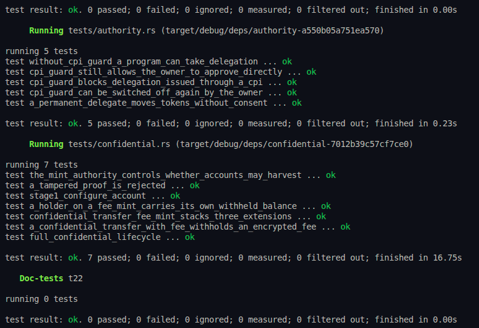

# Token-2022 Anchor Program

A Solana Anchor program showcasing the implementation and testing of **SPL Token-2022 (Token Extensions)**.

---

## Features & Extensions Demonstrated

- **Transfer Fees**: Mint configuration with bps/maximum fee, runtime fee calculation, and `transfer_checked_with_fee`.
- **Permanent Delegate**: Dedicated authority capable of executing privileged token transfers and seizures without owner signature.
- **Default Account State & KYC**: Mint-level default frozen accounts requiring authority verification to thaw (`unfreeze_after_kyc`).
- **CPI Guard Protection**: Enforces account protections blocking unauthorized delegations and transfers initiated through CPI.
- **Confidential Transfers & Fees**: Mints configured with ElGamal encryption proofs, confidential deposits, and pending balance application.
- **Declarative Mint Creation**: Uses Anchor's extension constraints to initialize mints with Close Authority and Metadata Pointers.

---

## Project Structure

```text
├── programs/t22/
│   ├── src/
│   │   ├── instructions/    # Individual instruction implementations
│   │   ├── constants.rs     # Program constants and seeds
│   │   ├── error.rs         # Custom error definitions
│   │   └── lib.rs           # Program entrypoints and module exports
│   └── tests/
│       ├── authority.rs     # LiteSVM tests: CPI Guard, Permanent Delegate, KYC thaw
│       └── confidential.rs  # LiteSVM tests: Confidential transfers, proofs, fees
├── Anchor.toml              # Anchor configuration
├── Cargo.toml               # Workspace configuration
└── rust-toolchain.toml      # Pinned toolchain (Rust 1.94.0+)
```

---

## Prerequisites

- **Rust**: `>= 1.94.0` (required by modern Agave / Solana syscalls)
- **Solana CLI / Agave**: `>= 2.1` / `3.1`
- **Anchor CLI**: `1.2.0`

---

## Getting Started

### 1. Build the Program & IDL

```bash
anchor build
```

To build only the IDL:

```bash
anchor idl build
```

### 2. Run Tests

Tests run against an in-memory [LiteSVM](https://crates.io/crates/litesvm) instance for fast execution:

```bash
anchor test
```

### Test Results


